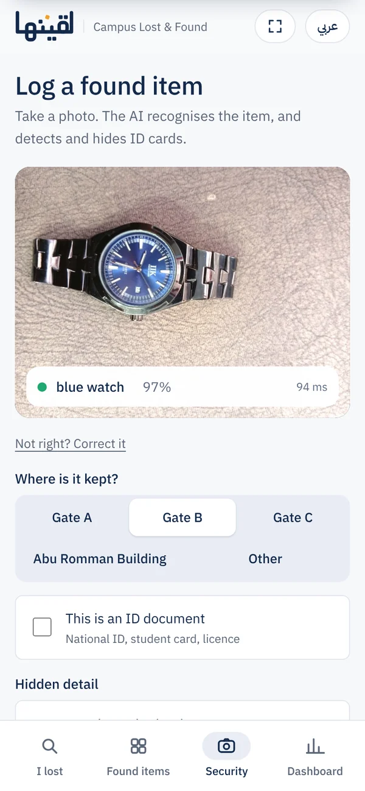
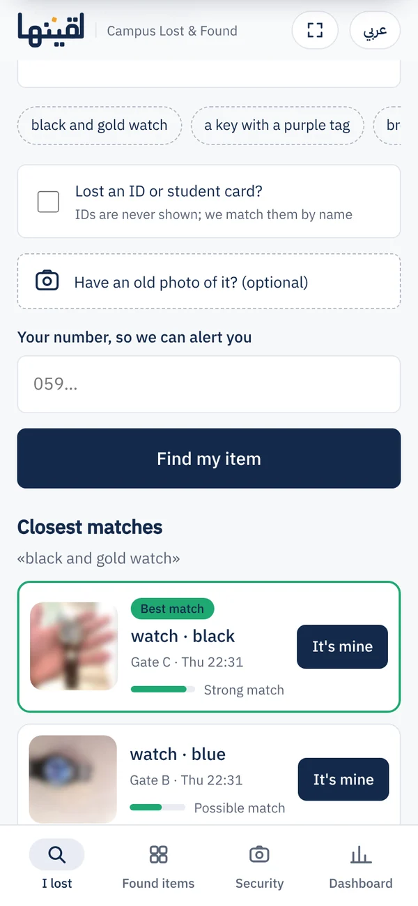
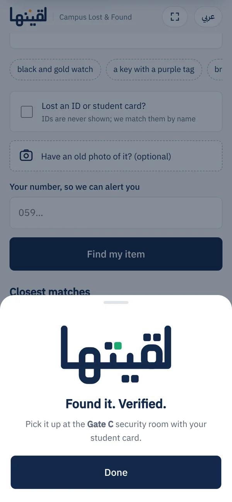
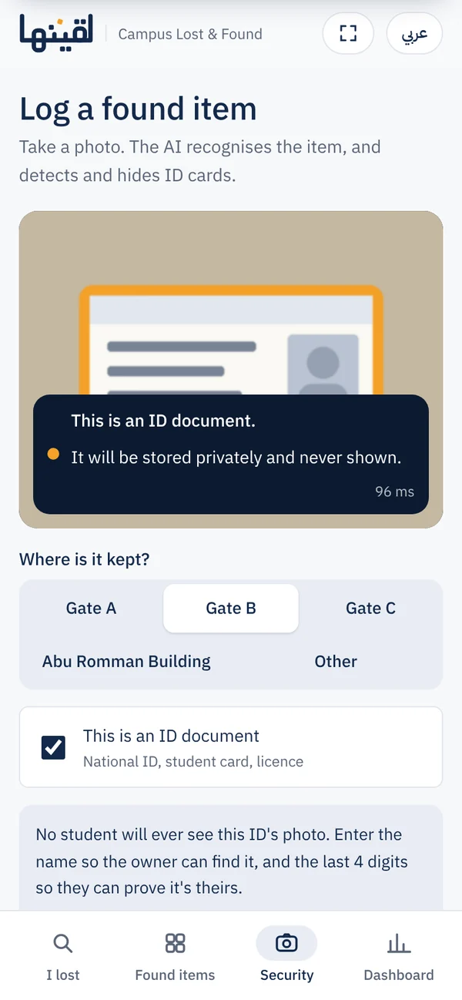
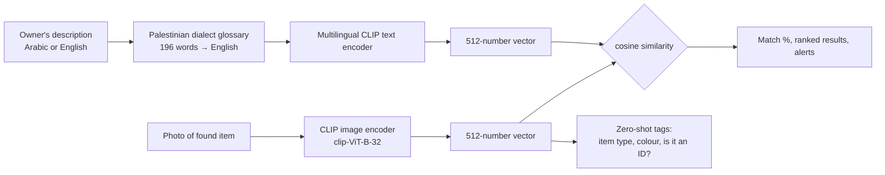

# لقيتها · Laqeetha — the app

**AI lost-and-found for universities that never shows an ID card to anyone.**
Describe what you lost the way you'd say it, in Palestinian Arabic or English, and the right item comes up. Security logs found items with one photo. ID cards are detected automatically and kept private.

Graduation project, Computer Science, Palestine Polytechnic University · exhibited at Palestine XI, 19–20 October 2026.

🌐 Project site: https://haithamak24.github.io/laqeetha/ · site source: [Haithamak24/laqeetha](https://github.com/Haithamak24/laqeetha)

| Security logs an item | Owner describes it | Claim verified | An ID card |
|:---:|:---:|:---:|:---:|
|  |  |  |  |

---

## Why

At PPU, found items get posted in WhatsApp groups. Out of 16 items posted between 16 Aug and 8 Oct 2026, **11 were identity documents, and all 11 showed the owner's name**. 7 showed the date of birth, 4 the face photo, and 1 the full national ID number. Source: [`evidence/`](evidence/). The table has no names, and the collage blurs every ID.

## What it does

| Who | What happens |
|---|---|
| **Security officer** | Takes a photo. The AI names the item (24 types) and its colour (15), and checks if it is an ID document. If the AI is unsure (under 60%), the officer picks the right name with one tap. Each item gets a storage location and a hidden detail only the owner would know. |
| **Owner** | Describes the item in their own words, in Arabic or English (optionally adding an old photo of it), and gets ranked matches. If it hasn't been found yet, the report stays open and the phone is alerted when a matching item is logged. |
| **Anyone** | Sees the public feed: a privacy-safe replacement for the WhatsApp group, with photos blurred and IDs never listed with a photo. |
| **Booth screen** (`/booth`) | A live, public view of what's happening: searches, logged items, verified claims. It only shows a visitor's words if every word is a known item, colour or place word. |

### Privacy rules (enforced by the server, not just the UI)

- **ID documents are never shown**, not even blurred: `/img/<id>` returns 403 for them.
- IDs are matched by the **owner's name**, because every ID card looks alike to the AI. They're claimed with the **last 4 digits** of the number.
- Normal items show only a **blurred** photo. Claiming one needs the **hidden detail**.
- **3 wrong answers lock** the item until security reviews it.
- The booth screen never shows names, numbers, hidden details or ID photos.

## How it works



- **One shared vector space.** CLIP maps a photo and a sentence describing it to nearby vectors, so search is just comparing vectors. There's no training on our side; the models are used as they are.
- **The dialect glossary is our main contribution.** The text model learned mostly formal Arabic, so "جزدان صغير اسود بسحاب" (a small black zip purse) ranked the right item 16th of 16. `app/arabic.py` translates the key dialect words to English first. The query vector is 0.8 × the English gloss + 0.2 × the raw Arabic, which keeps words the glossary doesn't know.
- **Tags** are zero-shot: the photo is compared with a written description of every category, averaged over several phrasings per category ("prompt ensembling", set v2).
- **Match %** maps raw cosine scores onto 0–100 using thresholds calibrated on the real test photos. An alert fires at 55% or more, and a photo almost identical to one already logged (cosine ≥ 0.95) is flagged as a likely duplicate.
- **Storage** is SQLite plus image files on disk. Search is brute-force cosine, which is fine up to roughly 100k items. Beyond that, the same vectors would go into pgvector or FAISS.

## Measured results

Real model, laptop CPU, offline, 15–16 Oct 2026, from [`real_test.py`](real_test.py). The search set is 6 real items plus the 10 ID cards as distractors (16 photos).

| Test | Result |
|---|---|
| ID cards detected automatically | **10 / 10**, 0 false alarms on the 6 normal items |
| Palestinian-Arabic description → right item ranked first | **12 / 12**; without the glossary **3 / 12** |
| English description → right item ranked first | **6 / 6** |
| Item named correctly (prompt set v2) | 6 / 7 (v1: 4 / 7) |
| Time to analyse one photo | 76–226 ms (three runs) |

The sample is small. Also, one glossary word (جزدان) was fixed after seeing these same descriptions, so 12/12 is optimistic. The next step is a pilot with campus security, which will give a larger, fresh test set.

## Run it

**Windows (what the booth laptop uses):** install Python 3.10+ with "Add to PATH" ticked, then:

| Script | What it does |
|---|---|
| `setup.bat` | One time, needs internet: creates `.venv`, installs packages, downloads the models (~600 MB), loads 6 demo items |
| `start.bat` | Starts the server at http://localhost:8000 (staff PIN `1234`); the booth screen is at `/booth` |
| `reset.bat` | Wipes all items and reports and reloads the 6 demo items |
| `test.bat` | Runs the accuracy test (needs the private ID photos, see below) |
| `try_photo.bat` | Drag any photo onto it to see the AI's top guesses |

**macOS / Linux:**

```bash
python3 -m venv .venv && source .venv/bin/activate
pip install -r requirements.txt
python seed.py                                   # downloads the models once, loads the demo items
uvicorn app.main:app --host 0.0.0.0 --port 8000
```

After setup it runs **fully offline**. A phone on the same Wi-Fi or hotspot opens `http://<laptop-ip>:8000`.

**Settings** (environment variables):

| Variable | Default | Meaning |
|---|---|---|
| `LF_PIN` | `1234` | Staff PIN for the Security tab and dashboard |
| `LF_DATA` | `./data` | Where the database and photos are stored |
| `LF_PROMPTS` | `v2` | Label prompt set (`v1` or `v2`); `test.bat` saves the measured winner |
| `LF_TEXT_LO`, `LF_TEXT_HI` | `0.22`, `0.32` | Cosine range mapped to 0–100% for text search |
| `LF_FAKE` | off | `1` = random vectors instead of the models, for UI work without the 600 MB download |

## API

| Method & path | Staff PIN | What it does |
|---|:---:|---|
| `POST /api/analyze` | ✓ | Tag a photo (item type, colour, ID probability) without saving |
| `POST /api/found` | ✓ | Log a found item; returns tags, duplicate warning, alerts sent |
| `POST /api/lost` | | Report a lost item and get ranked matches |
| `GET /api/lost/{id}/alerts` | | New matches for an open report (the phone polls this) |
| `GET /api/feed` | | Public list of available items (no hidden details) |
| `POST /api/claim/{id}` | | Answer the hidden detail / last 4 digits; 3 wrong tries lock |
| `GET /api/dashboard` | ✓ | Everything, including hidden details and claimants |
| `POST /api/found/{id}/status` | ✓ | Mark returned, or unlock a locked item |
| `GET /img/{id}` | | Blurred thumbnail; 403 for ID documents |
| `GET /api/events` | | The privacy-filtered event stream behind the booth screen |

The staff PIN is sent in the `X-Staff-Pin` header.

## Project layout

```
app/
  main.py          API, matching, privacy rules
  embedder.py      CLIP models, tagging, prompt sets v1/v2
  arabic.py        Palestinian dialect glossary + booth-screen word filter
  static/          index.html (the app), booth.html (booth screen), brand, fonts, icons, media
seed_photos/       the 6 demo items + test_queries.csv (the 18 test descriptions)
evidence/          WhatsApp post table (no names) + blurred collage
my_test_photos/    extra labelled photos for the label test
docs/              BOOTH_GUIDE.md · HOW_IT_WORKS.md · REQUIREMENTS.md · screens/
real_test.py       the accuracy test        try_photo.py   inspect one photo
seed.py            loads the demo items     *.bat          Windows helpers
```

**Never in this repo:** `private_test_photos/` (the real ID cards used by the test), `data/`, `.venv/`, and the test output. All of these are in `.gitignore`.

## Known limits

- A small test set (6 items, 10 IDs, 18 descriptions). Thresholds will need re-calibrating as it grows.
- Claims for normal items check by word overlap, not meaning. Final hand-over is done in person by security, against a student card.
- A shared staff PIN instead of real accounts. In production this would use university sign-in, and student cards could notify their owner directly through the student directory.

More in [`docs/HOW_IT_WORKS.md`](docs/HOW_IT_WORKS.md) and [`docs/REQUIREMENTS.md`](docs/REQUIREMENTS.md). Running the booth: [`docs/BOOTH_GUIDE.md`](docs/BOOTH_GUIDE.md).

## Team

- **Haitham Abu Khaled**: [LinkedIn](https://linkedin.com/in/haitham-abu-khaled)
- **Mostafa Natsheh**: [LinkedIn](https://www.linkedin.com/in/mostafa-natsheh/), animated the explainer film
- **Osama Abu Al-Halaweh**: [LinkedIn](https://www.linkedin.com/in/osama-abu-al-halaweh-30670b30a/)

Supervised by **Dr. Ezdehar Jawabreh**, Palestine Polytechnic University.
